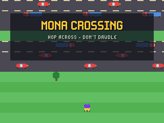
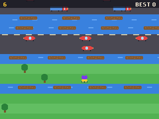
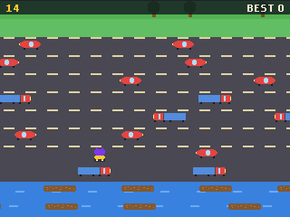

# Mona Crossing for the GitHub Universe 2026 badge

An endless road-and-river crosser for the GitHub Universe 2026 badge: hop tile by tile, dodge traffic, ride logs and never dawdle.

| Title | Early Rows | Traffic |
| --- | --- | --- |
|  |  |  |

## Install

1. Put the badge in USB Disk Mode (open the Mass Storage app, or double-tap
   RESET) so the `BADGER` volume appears.
2. Copy the `apps/mona_crossing` folder into `BADGER/apps/` (so you end up with
   `BADGER/apps/mona_crossing/__init__.py`).
3. If your badge still runs the stock event menu, its tiles ignore `icon.png`.
   The [hyb26 skill](https://github.com/badger/home/tree/main/.github/skills/hyb26-skill)
   ships `patch_menu_icons.py`, which adds that support (with a backup).
4. Eject the volume. The badge restarts into the menu with a Mona Crossing tile.

No network or extra hardware is needed. Scores are saved under `/state`.

## Controls

| Button | Action |
| --- | --- |
| Up / Down / Left / Right | Hop one tile |
| Select | Start; hop again after a splat |
| Back | Back to the title |

## How it works

- Rows are generated ahead on demand in runs: grass with trees to weave through, roads with cars and trucks in alternating directions, and rivers where only the logs are safe. Speeds rise with distance.
- Traffic travels round a loop slightly wider than the screen, so lanes stay evenly spaced without spawning logic. Standing in a road lane when a vehicle overlaps Mona, in a river without a log underfoot, or being carried off the edge ends the run.
- The camera follows Mona and creeps forward on its own once the run has started; falling behind it, or standing still for six seconds, also ends the run. Rows crossed are the score and the badge keeps the best.

The sprites are drawn from pixel maps by `tools/build_sprites.py`
(`python3 tools/build_sprites.py crossing apps/mona_crossing/assets`).

## Tools

- `tools/build_sprites.py` regenerates the sprite sheets.
- `tools/badge_harness.py` (with `tools/badge_kit.py` copied to `/state/kit.py`
  on the badge) drives the game's frame loop on a real badge over `mpremote
  run`, simulating button presses and saving run-length encoded screenshots
  to `/state/shots`; `tools/rle2png.py` converts them.

Mona is GitHub's Octocat mascot; this is a fan project and not affiliated
with GitHub.
